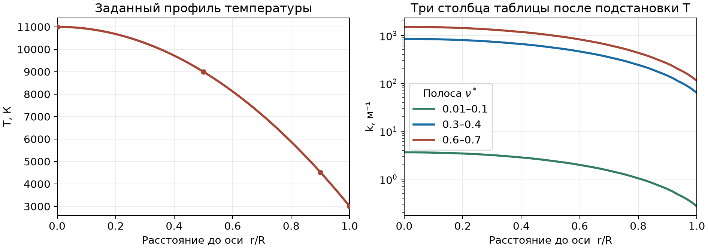
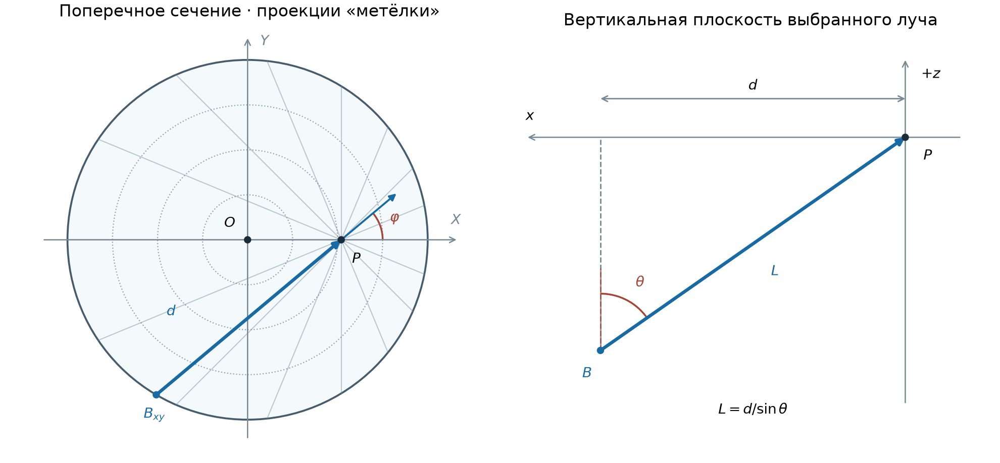

# Перенос теплового излучения в бесконечном цилиндре. Точный метод

Представим длинный столб горячего газа. Каждый его маленький объём испускает свет и поглощает часть света, пришедшего из других объёмов. Нас интересует, сколько энергии газ отдаёт излучению или получает от него **в выбранном месте и на выбранной частоте**. Например, горячая сердцевина может терять энергию, а более холодный газ у поверхности может поглощать свет сердцевины и нагреваться.

В программе мы берём один поперечный срез столба, выбираем несколько точек от оси до поверхности и в каждой восстанавливаем картину приходящего света. Для этого мысленно смотрим из точки во все стороны. В одном направлении виден длинный путь через горячую сердцевину, в другом ближайшая холодная граница, в третьем длинный путь почти вдоль оси. Эта пространственная «метёлка» направлений нужна, чтобы посчитать, сколько света приходит к точке и какая его часть переносит энергию наружу.

Для точного метода строятся два вида графиков. Первый показывает **спектр локального обмена энергией** между веществом и излучением. На нём отдельная кривая для каждого выбранного радиуса. Второй показывает **спектр оптической толщины** от оси до поверхности. По нему видно, какие частотные полосы легче пропускают свет. В исследовании этот график будет описывать условия сравнения точного и приближённого расчётов. Цилиндр, температурный профиль и таблица поглощения у обоих расчётов будут общими.

Основой для постановки служит раздел 1 преподавательского пособия. В этом разборе углы отсчитываются по явно заданным осям, а направление луча означает направление движения света. Связь с кодом дана для текущего расчёта в этом проекте. [Пособие преподавателя](../../guide.pdf)

## Содержание

1. [Цилиндр и входные данные](#inputs)
2. [Частотные полосы и радиальная оптическая толщина](#frequency)
3. [Геометрия луча и пространственная метёлка](#geometry)
4. [Испускание и поглощение вдоль одного луча](#transport)
5. [Интегрирование по направлениям и потоки](#angles)
6. [Дивергенция и локальный обмен энергией](#divergence)
7. [Как читать полученные графики](#plots)
8. [Устройство программы, запуск и проверки](#program)

## 1. Цилиндр и входные данные

### Какой цилиндр мы моделируем

Ось цилиндра направлена вдоль $z$. Поперечное сечение имеет радиус $R$, а торцы мысленно находятся бесконечно далеко. В декартовых координатах вещество занимает область $X^2+Y^2\le R^2$ при любом $z$. Внутри находятся излучающий и поглощающий газ, снаружи задано отсутствие падающего света. Температура $T_w$ задаёт температуру **газа у боковой границы**. Отдельной стенки со своим излучением и отражением в этой постановке нет.

Состояние газа зависит только от радиуса $\rho=\sqrt{X^2+Y^2}$. Две точки на одинаковом расстоянии от оси имеют одинаковые температуру и коэффициент поглощения. Благодаря этому любую точку наблюдения на радиусе $r$ можно представить как $P=(r,0,0)$. Здесь $r$ задаёт одну фиксированную точку, а $\rho$ будет меняться при движении вдоль луча через неё.

Мы считаем процесс стационарным. Поле температур задано, и программа не пересчитывает его после определения излучения. Среда поглощает и тепловым образом испускает свет, рассеяние опущено. Коэффициент преломления принимается равным единице, так что лучи прямые. Связь между тепловым испусканием и поглощением задаём через локальное термодинамическое равновесие, сокращённо ЛТР. Оно относится к свойствам вещества в каждой точке. Поле излучения при этом может отличаться от равновесного и зависит от остальных областей цилиндра. [Уравнение переноса и закон Кирхгофа при ЛТР](https://www.ita.uni-heidelberg.de/~dullemond/lectures/radtrans_2013/Chapter_3.pdf)

### Что задают параметры в main.py

$$
T(\rho)=T_0+(T_w-T_0)\left(\frac{\rho}{R}\right)^n.
$$

| Параметр в программе | Смысл | Текущее значение |
|---|---|---:|
| `T0` | $T_0$, температура на оси | 11 000 К |
| `TW` | $T_w$, температура газа у поверхности | 3 000 К |
| `R` | $R$, радиус цилиндра в метрах | 0,01 м |
| `N` | $n$, безразмерная степень в формуле температуры | 2 |
| `RADIUS_FRACTIONS` | Положения точек наблюдения $r/R$ | 0; 0,5; 0,9; 1 |
| `FREQUENCY_SCALE_HZ` | $\nu_{\mathrm{scale}}$, масштаб перевода табличной частоты в герцы | $10^{15}$ Гц |
| `TABLE_PATH` | Путь к входной таблице поглощения | `demo_opacity.txt` в учебном примере |

При $n>0$ температура на оси равна $T_0$, у поверхности равна $T_w$, между ними плавно меняется. В нашем примере

$$
T(\rho)=11\,000-8\,000(\rho/R)^2.
$$

При $\rho/R=0{,}5$ получаем $9000$ К, при $\rho/R=0{,}9$ получаем $4520$ К. Большая степень $n$ при тех же конечных температурах оставляет большую часть сечения ближе к $T_0$ и переносит резкое падение температуры к поверхности. При фиксированных $T_0,T_w,n$ изменение $R$ сохраняет профиль в координате $\rho/R$, но меняет физические длины путей, а значит, и поглощение.

Список `RADIUS_FRACTIONS` определяет, где будут вычислены кривые. Точка $r/R=1$ означает предел со стороны газа на боковой поверхности. Программа может вычислить спектр в отдельной точке, потому что температура вдоль приходящих туда лучей задана аналитически. Плотная сетка точек наблюдения нужна для исследования зависимости от радиуса, а не для решения каждого отдельного луча.

### Что находится в таблице

На каждой частоте материал по-своему взаимодействует со светом. Один и тот же сантиметр газа может оказаться почти прозрачным для одной полосы и практически непрозрачным для другой. Коэффициент **линейного поглощения** $k_\nu$ описывает это свойство в расчёте. Он имеет размерность $\mathrm{м^{-1}}$. В однородной среде без собственного испускания пучок после пути $L$ сохраняет долю $e^{-k_\nu L}$ входной интенсивности. Если $k_\nu>0$, величина $1/k_\nu$ — длина пути, на которой эта доля падает до $e^{-1}\approx0{,}368$.

Таблица задаёт $k_\nu$ как функцию **двух аргументов**. Температура определяет строку или положение между строками. Частота определяет столбец. Вот фрагмент в формате, который читает программа. Для краткости оставлены первые четыре столбца и две строки температур.

~~~text
0.01-0.1, 0.1-0.2, 0.2-0.3, 0.3-0.4
7000K
1.47, 7.35, 31.85, 343
8000K
1.92, 9.6, 41.6, 448
~~~

Заголовок содержит интервалы безразмерной координаты $\nu^*$. После него идут пары строк с температурой и рядом коэффициентов. В файле десятичные числа пишутся через точку, а значения в ряду можно разделять запятыми или пробелами. Пустые строки и комментарии после символа `#` пропускаются. Полосы должны идти по возрастанию и могут иметь общую границу. Между полосами допустим промежуток, если для него нет данных. Температуры должны идти по возрастанию. Коэффициенты могут быть нулевыми.

Пусть $\nu^*=0{,}35$, а температура в конкретной точке луча равна $7500$ К. Частота попадает в четвёртый столбец. Значения на соседних строках составляют $343$ и $448\ \mathrm{м^{-1}}$. Для промежуточной температуры используется линейная интерполяция.

$$
k(7500\,\mathrm K)=343+\frac{7500-7000}{8000-7000}(448-343)
=395{,}5\ \mathrm{м^{-1}}.
$$

Общая формула для столбца $b$ с температурами $T_i\le T\le T_{i+1}$ выглядит так.

$$
k_b(T)=k_{i,b}+(k_{i+1,b}-k_{i,b})\frac{T-T_i}{T_{i+1}-T_i}.
$$

В пределах одного столбца частота может меняться, а $k_b(T)$ при фиксированной температуре остаётся одним и тем же. При переходе в другой столбец берётся другой набор коэффициентов. Программа интерполирует **по температуре**. Спектральное поведение внутри полосы задано самим предположением о постоянном $k_\nu$.

Таблица нужна для трёх операций. Во-первых, она даёт ослабление света на каждом отрезке луча. Во-вторых, по закону Кирхгофа тот же коэффициент входит в местное тепловое испускание $j_\nu=k_\nu B_\nu(T)$. В-третьих, его интеграл от оси до поверхности даёт $\tau_\nu$. Коэффициенты в демонстрационном файле синтетические. В строках использован закон $k_b(T)=k_b(10\,000\,\mathrm K)(T/10\,000\,\mathrm K)^2$, а между строками программа пользуется линейной интерполяцией. Две усиленные полосы выбраны по положению групп линий ксенона. Амплитуды подобраны для демонстрации разных оптических толщин. Для количественного расчёта конкретного газа нужны его коэффициенты в заданных условиях, включая состав, давление или плотность, в зависимости от источника таблицы. [Демонстрационная таблица](demo_opacity.txt) · [Группы линий ксенона, рис. 3 препринта ИПМ](https://keldysh.ru/papers/2022/prep2022_57.pdf)

**Связь с кодом.** В [opacity_table.py](opacity_table.py) функция `load_opacity_table` читает файл и возвращает `OpacityTable`. Поле `bands` имеет форму `[полоса, 2]` и хранит левую и правую границы. `temperatures_k` хранит температуры строк. `coefficients_m_inv` имеет форму `[температура, полоса]`. Метод `interpolate(temperature_k, band)` выбирает столбец и использует `np.interp`, в том числе сразу для массива температур. В [exact_method.py](exact_method.py) функция `solve_exact` проверяет, что весь профиль лежит в пределах таблицы. Вложенная функция `temperature(rho)` вычисляет $T$ по скаляру или массиву расстояний до оси.

## 2. Частотные полосы и радиальная оптическая толщина

### Частота, с которой работает программа

Физическая частота $\nu$ измеряется в герцах. В файле используется безразмерная координата

$$
\nu^*=\frac{\nu}{\nu_{\mathrm{scale}}},\qquad
\nu=\nu^*\nu_{\mathrm{scale}}.
$$

Для этого демонстрационного файла $0{,}35$ соответствует $3{,}5\cdot10^{14}$ Гц. При замене таблицы нужно сверить определение её $\nu^*$ и единицы $k$. Масштаб частоты нужен для вычисления функции Планка. Сам коэффициент поглощения относится к столбцу и берётся в $\mathrm{м^{-1}}$.

По каждой полосе программа вычисляет дивергенцию в девяти частотных точках, включая оба конца. Например, частота $\nu^*=0{,}3$ одновременно является правым концом полосы $0{,}2$–$0{,}3$ и левым концом полосы $0{,}3$–$0{,}4$. Эти два расчёта используют разные столбцы $k$. Они дают односторонние значения по разные стороны от перехода. Частоты идут по горизонтальной оси графиков. Вертикальная ось дивергенции при этом выражена **на один герц физической частоты**. Если понадобилась бы спектральная плотность на единицу $\nu^*$, пришлось бы умножить её на $\nu_{\mathrm{scale}}$, так как $d\nu=\nu_{\mathrm{scale}}d\nu^*$.

**Связь с кодом.** `np.linspace(..., axis=1)` в `solve_exact` создаёт двумерный массив `nu_star[полоса, отсчёт]`. Выражение `frequency_hz = nu_star * frequency_scale_hz` готовит частоты для формулы Планка. Параметр `frequency_samples` регулирует детализацию внутри полос. Дополнительные точки уточняют её кривую, сохраняя исходные значения поглощения.

### Как измерить, прозрачен ли радиальный путь

Мысленно направим пробный пучок из оси к поверхности. На маленьком пути $d\rho$ коэффициент $k_\nu(T(\rho))$ даёт вклад $d\tau_\nu=k_\nu(T(\rho))\,d\rho$ в оптическую толщину. Сумма вкладов описывает ослабление **самого пробного пучка**. Среда может одновременно добавлять своё излучение, которое учитывается отдельным расчётом в разделе 4.

$$
\tau_\nu^{\mathrm{rad}}=\int_0^R k_\nu(T(\rho))\,d\rho.
$$

Интегрируем по расстоянию в метрах, поэтому произведение $k_\nu\,d\rho$ и итоговая $\tau_\nu$ безразмерны. Частота фиксирована на протяжении всего интеграла. Если $k_\nu$ постоянен вдоль пути, $\tau_\nu^{\mathrm{rad}}=k_\nu R$. Для заданного профиля удобна также запись

$$
\tau_\nu^{\mathrm{rad}}
= R\int_0^1 k_\nu\bigl(T_0+(T_w-T_0)\xi^n\bigr)\,d\xi,
\qquad \xi=\rho/R.
$$

Оптическая толщина конкретного луча до точки наблюдения вычисляется по его собственной длине $\int k_\nu\,ds$. Для наклонного луча от границы к оси путь через те же радиальные слои длиннее в $1/\sin\theta$ раз. Для поперечного пути через весь диаметр толщина равна $2\tau_\nu^{\mathrm{rad}}$. Луч, проходящий вдали от оси, может обойти горячие слои. Поэтому $\tau_\nu^{\mathrm{rad}}$ служит ориентиром прозрачности, а затухание каждого направления определяет его собственная траектория. [Закон ослабления и оптическая толщина](https://www.ita.uni-heidelberg.de/~dullemond/lectures/radtrans_2013/Chapter_3.pdf)

**Связь с кодом.** `radial_steps=4096` задаёт число отрезков радиуса для этой операции. `dr = R / radial_steps`, `tau_temperature` содержит температуры в серединах этих отрезков. Для каждого столбца программа складывает значения $k_\nu$ в серединах и умножает на `dr`. Это формула средних прямоугольников.

$$
\tau_\nu^{\mathrm{rad}}\approx
\Delta\rho\sum_{i=0}^{N_r-1}
k_\nu\!\left(T\!\left((i+\tfrac12)\Delta\rho\right)\right),
\quad
N_r=\texttt{radial\_steps},\quad \Delta\rho=R/N_r.
$$

Здесь $N_r$ относится только к интегралу оптической толщины. Он не задаёт число точек наблюдения или разбиение каждого луча. Получаем одно число `tau_radial[b]` для каждой полосы, поскольку в рамках полосы коэффициент при любой температуре совпадает для всех её частот.

## 3. Геометрия луча и пространственная метёлка

### Откуда приходит свет

В точке $P$ выбираем направление движения фотонов. Затем смотрим **навстречу** этому направлению, чтобы найти входную точку $B$ на поверхности. Нас интересует путь $B\to P$. Для другого направления входная точка и пройденные температурные слои будут другими. Если мысленно нарисовать все такие пути, сходящиеся к $P$, получится пространственная «метёлка». На рисунке слева видны её проекции на поперечное сечение.

На левой схеме $O$ — центр сечения, концентрические окружности показывают слои с постоянной температурой, а $B_{xy}$ — проекция входной точки $B$. Синяя стрелка показывает движение света к $P$. Справа этот же луч показан в его вертикальной плоскости. Вертикаль на рисунке параллельна оси цилиндра.

### Два угла относятся к направлению, а не к положению точки

Зададим $\theta$ как угол направления света с осью $+z$, а $\varphi$ как угол его проекции на поперечную плоскость с наружным радиальным направлением $+X$ в точке $P$. Полный диапазон $\theta$ от $0$ до $\pi$, а $\varphi$ от $0$ до $2\pi$. Единичный вектор направления

$$
\boldsymbol\Omega=(\sin\theta\cos\varphi,\ \sin\theta\sin\varphi,\ \cos\theta).
$$

- $\theta=\pi/2$ означает, что луч лежит в поперечном сечении.
- При малом $\theta$ луч идёт почти вдоль оси. Его поперечная проекция коротка по сравнению с реальным путём.
- $\varphi=0$ означает наружное направление проекции в точке наблюдения. Такой луч приходит к $P$ со стороны оси.
- $\varphi=\pi$ означает направление к оси. В точку $P$ свет приходит с ближайшей стороны цилиндра.
- $\cos\varphi=0$ означает, что в точке $P$ радиальная проекция равна нулю. Такой луч может присутствовать в поле излучения и поглощаться, хотя не даёт радиального потока через площадку в $P$.

### Длина пути до поверхности

Введём $s_{\mathrm{back}}\ge0$ как расстояние от $P$ назад вдоль луча, против $\boldsymbol\Omega$. Координаты точки луча равны $\mathbf P-s_{\mathrm{back}}\boldsymbol\Omega$. В коде удобнее сначала работать с поперечной проекцией

$$
x=s_{\mathrm{back}}\sin\theta.
$$

Здесь $x$ — длина проекции пройденного пути, тогда как $X$ — глобальная декартова координата. Они связаны так.

$$
X=r-x\cos\varphi,\qquad
Y=-x\sin\varphi,\qquad
z=-s_{\mathrm{back}}\cos\theta.
$$

Расстояние этой точки до оси

$$
\rho(x)=\sqrt{(r-x\cos\varphi)^2+(x\sin\varphi)^2}
=\sqrt{r^2-2rx\cos\varphi+x^2}.
$$

Боковая поверхность находится там, где $\rho(x)=R$. При $0\le r<R$ положительный корень уравнения $x^2-2r\cos\varphi\,x+r^2-R^2=0$ даёт длину проекции от $P$ до $B$.

$$
d=r\cos\varphi+\sqrt{R^2-r^2\sin^2\varphi},
\qquad L=\frac{d}{\sin\theta}.
$$

Вектор $\boldsymbol\Omega$ направлен от $B$ к $P$, а $x$ отсчитывается от $P$ в сторону $B$. Поэтому во время переноса света по лучу $x$ уменьшается от $d$ до нуля. Когда понадобится интеграл с координатой, растущей **по ходу света**, назовём её $s$, положим $s=0$ на входе и $s=L$ в точке $P$. Тогда $x=(L-s)\sin\theta$.

На оси $r=0$ проекция всегда имеет длину $R$, а реальная длина равна $R/\sin\theta$. Для точки $r=R/2$, поперечного луча и $\varphi=0$ получаем $d=1{,}5R$. Свет приходит с дальней поверхности, проходит через ось и затем доходит до $P$. При $\varphi=\pi$ он приходит с ближайшей поверхности, и путь равен $0{,}5R$. Если оставить $\varphi=0$, но выбрать $\theta=60^\circ$, проекция останется $1{,}5R$, а реальный путь станет $1{,}5R/\sin60^\circ\approx1{,}732R$. Для нашего цилиндра это около $1{,}73$ см.

У строго осевых лучей $\sin\theta=0$, и они не пересекают боковую границу. Эти два направления имеют нулевой телесный угол, а угловая квадратура использует внутренние узлы. Около осевых направлений длина остаётся конечной для каждого наклонного луча, хотя может быть большой. В точке на поверхности $r=R$ для входящих направлений ближайшая граница уже совпадает с $P$, так что $L=0$ и интенсивность равна заданному внешнему значению, то есть нулю.

**Связь с кодом.** `_directions` возвращает $\sin\theta$, $\cos\varphi$, $\sin\varphi$ и веса углов. `_ray_midpoints` вычисляет `distance_xy`, то есть $d$, и длины отрезков `ds` вдоль луча. Для лучей на ближнюю сторону формула для $d$ рационализирована. Если $a=r\cos\varphi<0$, численно удобнее считать

$$
d=\frac{(R-r)(R+r)}
{\sqrt{(R-r)(R+r)+a^2}-a}.
$$

Эта запись избегает вычитания двух близких по модулю чисел около поверхности. `fractions` содержит границы отрезков в порядке от $B$ к $P$. Используется сгущение к точке наблюдения $x_i/d=(1-i/N_s)^3$, где $N_s$ — число отрезков. Поэтому вблизи $P$ лучше разрешается тонкий слой, из которого доходит свет в сильно поглощающей полосе. Массив `x = midpoints[:, None] * distance_xy[None, :]` содержит координаты середин с осями `[отрезок, луч]`. Длины `ds` вычисляются умножением разности соседних долей на $d/\sin\theta$. `np.hypot(r - x*cos_phi, x*sin_phi)` даёт $\rho$ каждой середины, после чего `temperature(midpoint_radii)` возвращает её температуру.

## 4. Испускание и поглощение вдоль одного луча

### Что движется по лучу

Вычисляемая величина $I_\nu(P,\boldsymbol\Omega)$ — **спектральная интенсивность** в выбранной точке и направлении. Она относится к узкому пучку, а не к одному фотону. Через площадку $dA_\perp$, перпендикулярную лучу, за время $dt$ проходит энергия

$$
dE=I_\nu\,dA_\perp\,dt\,d\nu\,d\Omega.
$$

Здесь $d\nu$ — ширина маленького интервала частот в герцах, а $d\Omega$ — телесный угол пучка в стерадианах. Соответственно, $I_\nu$ измеряется в $\mathrm{Вт/(м^2\,ср\,Гц)}$. В прозрачной среде без испускания интенсивность сохраняется вдоль прямого луча. Деление на квадрат расстояния применяется к другим величинам, например к потоку от точечного источника через расширяющуюся сферу. В уравнение для $I_\nu$ такой множитель не входит. [Интенсивность, телесный угол и поток](https://www.ita.uni-heidelberg.de/~dullemond/lectures/radtrans_2013/Chapter_2.pdf)

### Сколько добавляет и отнимает участок

Участок $ds$ по ходу света удаляет интенсивность $k_\nu I_\nu ds$ и добавляет $j_\nu ds$. Здесь $j_\nu$ — коэффициент испускания в данном направлении на единицу длины пути, с единицами $\mathrm{Вт/(м^3\,ср\,Гц)}$. Тепловое испускание в этой модели одинаково по направлениям. В условиях ЛТР применяем связь $j_\nu=k_\nu B_\nu(T)$.

$$
B_\nu(T)=\frac{2h\nu^3}{c^2}\frac{1}{\exp(h\nu/(k_\mathrm BT))-1}.
$$

| Обозначение | Смысл и роль |
|---|---|
| $B_\nu(T)$ | Интенсивность равновесного теплового излучения при температуре $T$. Она определяет местный источник при ЛТР и имеет те же единицы, что $I_\nu$. |
| $h=6{,}62607015\cdot10^{-34}\ \mathrm{Дж\cdot с}$ | Постоянная Планка. $h\nu$ — энергия фотона. |
| $k_\mathrm B=1{,}380649\cdot10^{-23}\ \mathrm{Дж/К}$ | Постоянная Больцмана. $k_\mathrm BT$ задаёт тепловой масштаб энергии. Отношение $h\nu/(k_\mathrm BT)$ безразмерно. |
| $c=299\,792\,458\ \mathrm{м/с}$ | Скорость света в вакууме, используемая в формуле Планка при принятом показателе преломления. |

Коэффициент поглощения $k_\nu$ и постоянная Больцмана $k_\mathrm B$ обозначены похожей буквой, но имеют разные смысл и размерность. В программе используются имена `ray_k` или `local_k` для поглощения и `BOLTZMANN_CONSTANT` для константы. Фактическая интенсивность $I_\nu(P,\boldsymbol\Omega)$ складывается из вкладов по пути и вообще отличается от местной $B_\nu(T(P))$.

Баланс на малом отрезке даёт уравнение переноса.

$$
\frac{dI_\nu}{ds}=j_\nu(s)-k_\nu(s)I_\nu(s)
=k_\nu(s)\big[B_\nu(T(s))-I_\nu(s)\big].
$$

Если $I_\nu<B_\nu$ и $k_\nu>0$, проход через этот газ увеличивает интенсивность. Если $I_\nu>B_\nu$, газ сильнее поглощает пучок, чем пополняет его. Изменение температуры вдоль луча меняет $B_\nu$ от участка к участку. [Формальное уравнение переноса и функция источника](https://www.ita.uni-heidelberg.de/~dullemond/lectures/radtrans_2013/Chapter_3.pdf)

### Что интегрируется вдоль пути

Координата $s$ здесь растёт от входной границы $B$ к $P$, от $0$ до $L$. Участок около $s$ испускает вклад $j_\nu(s)\,ds$. Он проходит оставшийся путь до $P$, и от него сохраняется доля $\exp[-\tau_\nu(s,L)]$. Поэтому формальное решение имеет вид

$$
\begin{aligned}
\tau_\nu(s,L)&=\int_s^L k_\nu(u)\,du,\\
I_\nu(P,\boldsymbol\Omega)&=
I_{\nu,b}e^{-\tau_\nu(0,L)}
+\int_0^L j_\nu(s)e^{-\tau_\nu(s,L)}\,ds.
\end{aligned}
$$

Внешний интеграл перебирает **места испускания вдоль одного луча**. Внутренний интеграл по $u$ считает поглощение **между конкретным местом испускания и точкой наблюдения**. Оба расстояния измеряются вдоль луча. В них подставляют $T(\rho)$ для соответствующих точек пути. В нашей постановке $I_{\nu,b}=0$, поэтому граничное слагаемое равно нулю. Вклад близкого к $P$ участка ослабляется меньше, а вклад из далёкой области зависит от её температуры, поглощения и прозрачности всех промежуточных слоёв.

### Как программа вычисляет тот же перенос через отрезки

Можно было бы явно считать вложенные интегралы. Текущая реализация разбивает луч на отрезки и последовательно переносит интенсивность от входа к точке наблюдения. На отрезке с индексом $i$ температура и поглощение берутся в середине. Обозначим их $T_i$, $k_{\nu,i}$, а длину отрезка $\Delta s_i$. При постоянных коэффициентах решение уравнения на этом отрезке даёт

$$
\begin{aligned}
\Delta\tau_i &= k_{\nu,i}\Delta s_i,\\
I_{i+1} &= I_i e^{-\Delta\tau_i}
+ B_\nu(T_i)(1-e^{-\Delta\tau_i}).
\end{aligned}
$$

Первый член переносит оставшуюся долю интенсивности со входа отрезка. Второй суммирует его собственное испускание с ослаблением внутри него. Действительно, интегрирование $k_{\nu,i}B_\nu(T_i)e^{-k_{\nu,i}(\Delta s_i-v)}$ по $v$ от $0$ до $\Delta s_i$ даёт $B_\nu(T_i)(1-e^{-\Delta\tau_i})$.

Например, при $\Delta\tau_0=0{,}2$ на первом отрезке с нулевым входом получим $I_1\approx0{,}1813 B_\nu(T_0^{\mathrm{seg}})$, где $T_0^{\mathrm{seg}}$ — температура середины первого отрезка, а $T_0$ в параметрах цилиндра обозначает температуру на оси. Если у второго отрезка $\Delta\tau_1=0{,}5$, то в конце второго останется около $0{,}6065I_1$ и добавится около $0{,}3935 B_\nu(T_1^{\mathrm{seg}})$. Продолжение по всем отрезкам постепенно учитывает поглощение каждого более раннего вклада на всех следующих участках.

Этот шаг аналитически точен для постоянных коэффициентов на отрезке. Численная ошибка связана с тем, что непрерывно меняющиеся $T$ и $k_\nu$ заменены значениями в серединах. В однородной среде при нулевом внешнем свете вся цепочка сводится к $I_\nu=B_\nu(1-e^{-k_\nu L})$. Уравнение вдоль луча первого порядка имеет известное входное значение. Достаточно последовательно обновлять $I$, и решать трёхдиагональную систему методом прогонки не требуется.

**Связь с кодом.** `_planck` вычисляет $B_\nu(T)$ в СИ. Для численной устойчивости он записывает фактор $1/(e^a-1)$ как $e^{-a}/(1-e^{-a})$, где $a=h\nu/(k_\mathrm BT)$. Вычисление $1-e^{-a}$ через `-np.expm1(-a)` точнее при малом $a$. В `_trace_band` массив `segment_source` хранит $B_\nu$ с осями `[отрезок, луч, отсчёт частоты]`. `optical_steps = ray_k * ds` имеет оси `[отрезок, луч]`, потому что коэффициент одинаков для всех частот данной полосы. Цикл идёт по отрезкам, а NumPy выполняет каждый шаг одновременно для всех лучей и отсчётов полосы. `transmission` представляет $e^{-\Delta\tau}$, `emission_weight` представляет $1-e^{-\Delta\tau}$. В конце `intensity` с формой `[луч, отсчёт частоты]` содержит искомую картину направлений в $P$ для одной полосы.

## 5. Интегрирование по направлениям и потоки

### Зачем складывать лучи двумя способами

После расчёта каждого луча мы знаем, сколько света приходит к точке с каждой стороны. Из этих данных можно ответить на два разных вопроса. Для поглощения важно **сколько всего света** присутствует в точке. Для радиального потока важно, **какая часть этого света пересекает площадку с радиальной нормалью и в какую сторону**. Луч, почти параллельный площадке, даёт небольшой вклад в пересечение, даже если его интенсивность большая.

Все направления можно изобразить точками единичной сферы. Элемент телесного угла в сферических координатах равен

$$
d\Omega=\sin\theta\,d\theta\,d\varphi,\qquad
\int_{4\pi}d\Omega=4\pi.
$$

Множитель $\sin\theta$ означает, что полоска направлений около полюса покрывает меньшую часть сферы, чем полоска той же ширины около экватора. Поэтому обычное среднее по равномерному списку углов $\theta$ и $\varphi$ в общем случае даёт неправильный результат.

### Средняя интенсивность

Фиксируем $r$ и $\nu$, затем интегрируем по двум углам.

$$
J_\nu(r)
=\frac{1}{4\pi}\int_{4\pi}I_\nu(r,\boldsymbol\Omega)\,d\Omega
=\frac{1}{4\pi}\int_0^{2\pi}\int_0^\pi
I_\nu(r,\theta,\varphi)\sin\theta\,d\theta\,d\varphi.
$$

В $J_\nu$ входят все направления с положительными угловыми весами. Средняя интенсивность измеряется в тех же единицах, что и $I_\nu$. Если полезно связать её с объёмной плотностью энергии излучения $u_\nu$, то при скорости света $c$ имеем $u_\nu=4\pi J_\nu/c$, в $\mathrm{Дж/(м^3\,Гц)}$. Гайд использует именно $u_\nu$ в формулах (4)–(6) первого раздела. Реализация использует непосредственно угловой интеграл в формуле дивергенции. [Определения угловых моментов](https://www.ita.uni-heidelberg.de/~dullemond/lectures/radtrans_2013/Chapter_2.pdf)

### Поток наружу и поток к оси

Полный вектор спектрального потока

$$
\mathbf F_\nu=\int_{4\pi}I_\nu\boldsymbol\Omega\,d\Omega.
$$

Осевые вклады компенсируются отражением относительно поперечного сечения. Касательные вклады компенсируются отражением относительно плоскости через $P$ и ось цилиндра. Остаётся радиальный поток $\mathbf F_\nu=F_\nu\mathbf e_r$, где $\mathbf e_r$ — наружный единичный радиальный вектор. В точке $P=(r,0,0)$ это направление $+X$. Радиальная проекция луча равна

$$
\mu_r=\boldsymbol\Omega\cdot\mathbf e_r=\sin\theta\cos\varphi.
$$

Интенсивность отнесена к площадке, перпендикулярной лучу. Радиальная площадка $dA$ видна лучу в проекции $\lvert\mu_r\rvert\,dA$. Отсюда множитель $\lvert\mu_r\rvert$ в модулях потоков и знак $\mu_r$ в их разности.

$$
\begin{aligned}
F_\nu^+(r)&=\int_{\mu_r>0}I_\nu\mu_r\,d\Omega,\\
F_\nu^-(r)&=\int_{\mu_r<0}I_\nu(-\mu_r)\,d\Omega,\\
F_\nu(r)&=F_\nu^+(r)-F_\nu^-(r)
=\int_{4\pi}I_\nu\mu_r\,d\Omega.
\end{aligned}
$$

Оба полупотока записаны неотрицательными, в $\mathrm{Вт/(м^2\,Гц)}$. Положительное $F_\nu$ означает результирующий перенос наружу. При раскрытии интеграла получается $I_\nu\sin^2\theta\cos\varphi\,d\theta\,d\varphi$. Один $\sin\theta$ приходит из телесного угла, второй из радиальной проекции. Для средней интенсивности второго множителя нет. Разделение на полупотоки здесь точное по определению. Каждый из них суммируется по всем своим направлениям.

На оси $\mathbf e_r$ можно выбрать по любой поперечной оси для подсчёта двух полупотоков. Симметрия даёт $F_\nu^+(0)=F_\nu^-(0)$, поэтому результат для полного потока равен нулю независимо от выбора. Излучение из противоположных направлений при этом присутствует.

### Как интеграл превращается во взвешенную сумму

В угловых интегралах удобно заменить $\theta$ переменной $\mu_z=\cos\theta$. Тогда $d\mu_z=-\sin\theta\,d\theta$, и при перестановке пределов мера интегрирования становится $d\mu_z\,d\varphi$.

В общем случае $\mu_z$ пробегает $[-1,1]$, а $\varphi$ — $[0,2\pi]$. Здесь отражение $\mu_z\mapsto-\mu_z$ сохраняет $\sin\theta$, длину пути и радиальную проекцию. Отражение $\varphi\mapsto2\pi-\varphi$ меняет только знак $Y$ вдоль луча и тоже сохраняет температуры и радиальную проекцию. Для интегралов $J_\nu$ и $F_\nu^\pm$ достаточно брать $\mu_z\in[0,1]$ и $\varphi\in[0,\pi]$, а суммарный вес умножить на четыре.

Для одной из этих переменных квадратура Гаусса — Лежандра задаёт узлы $v_i$ и веса $w_i$ на $[-1,1]$. Узлы лежат внутри интервала. Если требуются узлы для $[a,b]$, координаты и веса преобразуются так.

$$
v'_i=\frac{a+b}{2}+\frac{b-a}{2}v_i,
\qquad w'_i=\frac{b-a}{2}w_i.
$$

В двух измерениях берём все пары узлов и умножаем их веса. Для направления $m$ обозначим итоговый вес через $W_m$, уже включая отражения. Например,

$$
\begin{aligned}
J_\nu &\approx \frac{1}{4\pi}\sum_m W_m I_{\nu,m},\\
F_\nu^+ &\approx \sum_m W_m I_{\nu,m}\max(\mu_{r,m},0),\\
F_\nu^- &\approx \sum_m W_m I_{\nu,m}\max(-\mu_{r,m},0).
\end{aligned}
$$

Проверка нормировки состоит в том, что $\sum_m W_m=4\pi$ с точностью машинного округления. Это результат интегрирования единицы по сфере. Для постоянной по всем направлениям интенсивности $I_\nu=I_0$ тогда $J_\nu=I_0$. Ещё одна проверка для изотропного поля состоит в равенстве встречных потоков.

**Связь с кодом.** В `_directions` функция `leggauss` строит узлы и веса. Для $\mu_z$ берутся 20 узлов. Азимутальный диапазон дополнительно делится в $\pi/2$, где меняется знак $\mu_r$. На каждую половину берутся 24 узла. Вторая половина получается отражением первой относительно $\pi/2$. Итого программа трассирует $20\cdot(24+24)=960$ направлений на точку наблюдения, а отражённые направления учтены весами. В `solve_exact` массивы `outward_weights` и `inward_weights` уже содержат угловой вес и проекцию на радиус. После умножения на `intensity` операция `.sum(axis=0)` складывает лучи и оставляет частотные отсчёты.

## 6. Дивергенция и локальный обмен энергией

### Что показывает знак

Мысленно выделим небольшой объём газа. Через него свет может одновременно входить и выходить. Если из объёма выходит больше энергии излучения, чем входит, разницу в стационарной модели отдаёт вещество. Если входит больше, вещество получает энергию. Дивергенция $q_\nu=\nabla\cdot\mathbf F_\nu$ измеряет этот баланс **на единицу объёма и на единицу частоты**, в $\mathrm{Вт/(м^3\,Гц)}$.

| Знак $q_\nu$ | Что происходит на данной частоте |
|---|---|
| $q_\nu>0$ | Газ испускает больше, чем поглощает. Это радиационное охлаждение газа. |
| $q_\nu<0$ | Газ поглощает больше, чем испускает. Это радиационный нагрев газа. |
| $q_\nu=0$ | Местные испускание и поглощение уравновешены либо взаимодействие отсутствует. |

Температура задана, поэтому график показывает, каким **был бы вклад** этого обмена в баланс энергии. Саму температуру расчёт по этому графику не изменяет. В уравнение энергии вещества радиационный вклад входит со знаком $-q_\nu$.

### Связь с цилиндрическим потоком

Возьмём слой толщиной $dr$ и длиной $H$ вдоль оси. Через внешнюю поверхность его покидает мощность на единицу частоты $2\pi(r+dr)H F_\nu(r+dr)$, через внутреннюю поступает $2\pi rH F_\nu(r)$. Делим разность на объём $2\pi rH\,dr$ в пределе тонкого слоя. Получаем

$$
q_\nu(r)=\frac{1}{r}\frac{d}{dr}\left[r(F_\nu^+(r)-F_\nu^-(r))\right].
$$

Множитель $r$ перед потоком появляется потому, что цилиндрическая поверхность большего радиуса имеет большую площадь. На оси нужна предельная интерпретация. Если около неё $F_\nu(r)=ar+o(r)$ и поток гладкий, то $q_\nu(0)=2a$, где $a$ — наклон потока у оси. Так $F_\nu(0)=0$ совместимо с ненулевым охлаждением в центре.

### Как получить ту же величину без производной

Для фиксированного направления производная интенсивности вдоль луча равна $\boldsymbol\Omega\cdot\nabla I_\nu$. Интегрируем уравнение переноса по всей сфере направлений. Поскольку в этой постановке лучи прямые, $\boldsymbol\Omega$ для заданного направления не зависит от положения. Поэтому слева получаем $\nabla\cdot\int I_\nu\boldsymbol\Omega\,d\Omega$. Справа $j_\nu$ и $k_\nu$ в одной точке не зависят от направления.

$$
\begin{aligned}
q_\nu
&=4\pi j_\nu-k_\nu\int_{4\pi}I_\nu\,d\Omega\\
&=4\pi k_\nu\big[B_\nu(T(r))-J_\nu(r)\big]\\
&=k_\nu\int_{4\pi}\big[B_\nu(T(r))-I_\nu(r,\boldsymbol\Omega)\big]\,d\Omega.
\end{aligned}
$$

Здесь $4\pi j_\nu$ — объёмное испускание по всем направлениям, а $4\pi k_\nu J_\nu$ — объёмное поглощение. В точке около оси может быть $B_\nu>J_\nu$, поскольку часть излучения уходит, а приходящий из периферии свет слабее. На холодной периферии может быть $J_\nu>B_\nu$, поскольку туда приходит свет горячей сердцевины. Эта формула сохраняет смысл на оси и позволяет вычислить $q_\nu$ даже в одной отдельно выбранной точке. Для неё не надо брать разность численных потоков на соседних радиусах.

### Зачем код переносит ещё одну величину вдоль луча

В оптически толстой изотермической области $I_\nu$ может почти совпадать с $B_\nu$. Если сначала округлить обе величины, а потом вычесть, маленькая разность теряет точность. Поэтому код одновременно переносит интенсивность $I$ и величину $D=B_{\mathrm{loc}}-I$, где $B_{\mathrm{loc}}=B_\nu(T(P))$ фиксирована в течение всего расчёта луча. $D$ может быть как положительной, так и отрицательной. На входе $I_0=0$, так что $D_0=B_{\mathrm{loc}}$.

Подставив формулу для $I_{i+1}$ из раздела 4, получаем эквивалентный шаг.

$$
D_{i+1}=D_i e^{-\Delta\tau_i}
+(B_{\mathrm{loc}}-B_\nu(T_i))(1-e^{-\Delta\tau_i}).
$$

В изотермическом случае второе слагаемое равно нулю, и маленькая разность рассчитывается напрямую через затухание. В неоднородной среде второе слагаемое учитывает разницу между температурой отрезка и температурой точки наблюдения.

**Связь с кодом.** `_trace_band` возвращает `intensity` для вычисления потоков и `deficit` для дивергенции. В `solve_exact` значение `local_k` берётся при температуре точки $P$, тогда как `ray_k` относится ко всем отрезкам луча. Строка `local_k * (deficit * angular_weights[:, None]).sum(axis=0)` соответствует $k_\nu(r)\sum_m W_m D_{\nu,m}$. Радиальной проекции $\mu_r$ здесь нет, поскольку для поглощения учитывается всё излучение. $J_\nu$ участвует в физической формуле, но отдельно в `TransferResult` не сохраняется.

## 7. Как читать полученные графики

### Оптическая толщина

Числа ниже относятся к учебному запуску с `demo_opacity.txt` на исходной равномерной сетке вдоль луча. Рисунки показывают результат для таблицы, выбранной в текущем `main.py`.

Каждая ступень — одна полоса входной таблицы. Высота ступени показывает $\tau_\nu^{\mathrm{rad}}$ вдоль пути длиной $R$ от оси до поверхности. График использует логарифмическую вертикальную ось, поскольку в демонстрационной таблице все толщины положительны и отличаются на несколько порядков. Горизонтальная отметка $\tau_\nu=1$ соответствует пропусканию $e^{-1}\approx37\%$.

| Полоса $\nu^*$ | $\tau_\nu^{\mathrm{rad}}$ | Доля пробного пучка, прошедшая путь $R$ |
|---|---:|---:|
| 0,01–0,1 | 0,02259 | 97,8% |
| 0,2–0,3 | 0,4894 | 61,3% |
| 0,3–0,4 | 5,270 | 0,514% |
| 0,5–0,6 | 0,9787 | 37,6% |
| 0,6–0,7 | 9,411 | 0,00818% |
| 0,7–0,8 | 2,710 | 6,65% |

Например, полоса 0,6–0,7 сильно ослабляет прямой вклад из центра на пути к границе. Газ ближе к границе сам излучает в этой полосе, и более короткие пути оттуда имеют другую оптическую толщину. Поэтому по одному $\tau_\nu^{\mathrm{rad}}$ нельзя получить выходящий спектр или локальное охлаждение. Для этого нужна температура вдоль лучей и расчёт испускания с поглощением.

**Связь с кодом.** `_save_tau` в [plots.py](plots.py) рисует горизонтальный отрезок каждой полосы по `result.tau_radial` и соединяет ступени на общих границах. Если в таблице есть пропуски частот, на этих частотах линия отсутствует. Логарифмическая шкала включается, только если все толщины положительны.

### Дивергенция потока

Каждая кривая показывает изменение $q_\nu$ **по частоте при фиксированном радиусе**. Цвета подписаны долями $r/R$. Горизонтальная линия на нуле отделяет положительный вклад в охлаждение от отрицательного. Обозначение `1e−4` около вертикальной оси означает множитель $10^{-4}$ для её числовых делений. Например, деление $1{,}5$ соответствует $1{,}5\cdot10^{-4}\ \mathrm{Вт/(м^3\,Гц)}$.

На частоте $\nu^*=0{,}35$ программа получает следующие числа. В таблице $J_\nu$ восстановлена из рассчитанного $q_\nu$ по формуле $J_\nu=B_\nu-q_\nu/(4\pi k_\nu)$.

| $r/R$ | $T$, К | $k_\nu$, м⁻¹ | $B_\nu$, Вт/(м²·ср·Гц) | $J_\nu$, Вт/(м²·ср·Гц) | $q_\nu$, Вт/(м³·Гц) |
|---:|---:|---:|---:|---:|---:|
| 0 | 11 000 | 847 | $1{,}754\cdot10^{-7}$ | $1{,}702\cdot10^{-7}$ | $+5{,}533\cdot10^{-5}$ |
| 0,5 | 9 000 | 567 | $1{,}157\cdot10^{-7}$ | $1{,}058\cdot10^{-7}$ | $+7{,}041\cdot10^{-5}$ |
| 0,9 | 4 520 | 144,76 | $1{,}576\cdot10^{-8}$ | $2{,}337\cdot10^{-8}$ | $-1{,}383\cdot10^{-5}$ |
| 1 | 3 000 | 63 | $2{,}349\cdot10^{-9}$ | $1{,}638\cdot10^{-8}$ | $-1{,}111\cdot10^{-5}$ |

В центре оба полупотока составляют примерно $5{,}326\cdot10^{-7}\ \mathrm{Вт/(м^2\,Гц)}$, поэтому $F_\nu(0)=0$. Положительная дивергенция показывает, что в этой точке газ всё же отдаёт энергию излучению. У поверхности $F_\nu^-(R)=0$, а $F_\nu^+(R)\approx1{,}464\cdot10^{-7}\ \mathrm{Вт/(м^2\,Гц)}$. Свет выходит наружу, но **местный** газ у поверхности поглощает больше, чем излучает. Положительный выходящий поток и отрицательная локальная дивергенция описывают разные аспекты переноса.

Высокое $k_\nu$ увеличивает местное испускание при неизменном $B_\nu$, но также увеличивает поглощение и меняет $J_\nu$ во всём цилиндре. Поэтому пик $\tau_\nu$ может совпасть с провалом $q_\nu$. Например, в центре при подходе к $\nu^*=0{,}3$ слева программа даёт примерно $8{,}749\cdot10^{-5}\ \mathrm{Вт/(м^3\,Гц)}$, а справа примерно $4{,}330\cdot10^{-5}\ \mathrm{Вт/(м^3\,Гц)}$. Частота одинакова, а коэффициенты разных столбцов изменяют глубину, с которой излучение приходит в точку.

Внутри полосы $k_\nu$ при фиксированной температуре постоянен, но $B_\nu(T)$ меняется по частоте. Поэтому $\tau_\nu$ рисуется ступенями, а $q_\nu$ плавно меняется внутри каждой полосы. Вертикальный пунктир соединяет **односторонние значения при одной частоте** и показывает величину скачка. Он не представляет вычисленные промежуточные значения. Если увеличить число частотных отсчётов, участки внутри полос прорисуются подробнее, а скачки сохранятся.

**Связь с кодом.** `result.div_flux` содержит спектры для всех точек наблюдения. В `_save_spectra` массивы `nu_star.T` и `spectrum.T` передаются в `ax.plot` так, чтобы Matplotlib рисовал каждую полосу отдельно. `shared` отмечает общие границы. Для них `ax.vlines` соединяет последний отсчёт предыдущей полосы и первый отсчёт следующей. Потоки $F_\nu^\pm$ и $F_\nu$ программа возвращает в результате, но на графике дивергенции они не рисуются.

Если понадобится мощность обмена в частотном диапазоне, нужно отдельно проинтегрировать $q_\nu$ по $\nu$ в герцах, например посчитать $\int_{\nu_a}^{\nu_b}q_\nu(r)\,d\nu$. Тогда единицы станут $\mathrm{Вт/м^3}$. Для интеграла по нескольким полосам удобно суммировать вклады отдельных полос, у которых заданы данные. Текущий график показывает именно спектральную плотность, без такого суммирования.

## 8. Устройство программы, запуск и проверки

### Как данные проходят через файлы

| Файл | Что в нём происходит |
|---|---|
| [main.py](main.py) | Хранит параметры запуска, вызывает чтение таблицы, `solve_exact` и сохранение графиков. |
| [demo_opacity.txt](demo_opacity.txt) | Задаёт температурные строки, частотные полосы и значения $k_\nu$. |
| [opacity_table.py](opacity_table.py) | Проверяет формат, собирает `OpacityTable` и интерполирует $k_\nu$ по температуре. |
| [exact_method.py](exact_method.py) | Вычисляет геометрию, перенос по лучам, угловые интегралы и радиальную оптическую толщину. |
| [requirements.txt](requirements.txt) | Перечисляет NumPy для численного расчёта и Matplotlib для построения графиков. |

Функция `main` загружает `table` и передаёт её вместе с `T0, TW, R, N` в `solve_exact`. Масштаб частоты и радиусы наблюдения передаются именованными аргументами. Сначала `solve_exact` определяет частоты, точки наблюдения, угловые веса и радиальную оптическую толщину. Затем для каждой точки строит геометрию и температуры вдоль лучей. Они общие для всех полос, поэтому вычисляются один раз на точку. Внутренний цикл перебирает полосы, выбирает свой столбец поглощения, рассчитывает интенсивности и складывает их по направлениям.

~~~text
main
  ├─ load_opacity_table  →  OpacityTable
  ├─ solve_exact
  │    ├─ радиальный интеграл  →  tau_radial
  │    ├─ _directions  →  углы и веса
  │    └─ для каждой точки наблюдения
  │         ├─ _ray_midpoints  →  радиусы и длины отрезков
  │         └─ для каждой полосы
  │              ├─ interpolate и _planck  →  k и B вдоль лучей
  │              ├─ _trace_band  →  I и B_local − I в точке
  │              └─ суммы по лучам  →  F+, F−, div F
  ├─ solve_schuster_schwarzschild  →  двухпоточный расчёт
  └─ save_comparison_plots  →  графики методов и сравнения в output
~~~

В `TransferResult` для демонстрационного запуска находятся массивы следующих форм.

| Поле | Оси | Форма |
|---|---|---|
| `radii_m` | точка наблюдения | `(4,)` |
| `nu_star` | полоса, частотный отсчёт | `(10, 9)` |
| `tau_radial` | полоса | `(10,)` |
| `flux_plus`, `flux_minus`, `div_flux` | точка наблюдения, полоса, частотный отсчёт | `(4, 10, 9)` |
| `flux` | те же оси, вычисляется как `flux_plus - flux_minus` | `(4, 10, 9)` |

Например, `result.div_flux[0, 3, 4]` — дивергенция на оси, в четвёртой полосе и в её центральном отсчёте $\nu^*=0{,}35$. Временные массивы по лучам и отрезкам не накапливаются для всех точек и полос. NumPy обрабатывает векторы направлений одновременно, а циклы Python читаются в том же порядке, в каком устроена физическая задача.

### Что означает «точный» и какие сетки влияют на ответ

Точный метод здесь сохраняет зависимость $I_\nu$ от направления и решает уравнение переноса вдоль прямых лучей. Для численного ответа используются конечные сетки, а сам материал описан табличными полосами. Разные настройки отвечают за разные приближения.

| Настройка `solve_exact` | Значение по умолчанию | Что меняется при увеличении |
|---|---:|---|
| `ray_steps` | 192 | Базовое число отрезков луча. При $\tau_\nu^{\mathrm{rad}}\ge100$ код использует в четыре раза больше отрезков. |
| `polar_order` | 20 | Добавляются узлы наклона к оси. |
| `azimuth_order` | 24 | Добавляются направления в каждой половине диапазона азимута. |
| `radial_steps` | 4096 | Точнее интегрируется $\tau_\nu^{\mathrm{rad}}$. |
| `frequency_samples` | 9 | Добавляются частотные отсчёты внутри каждой полосы. |
| `radius_fractions` | 4 точки в примере | Спектры вычисляются в большем числе мест. |

При очень большом поглощении важны ближние к точке участки с характерной длиной порядка $1/k_\nu$. Если этот масштаб намного меньше длины сегмента, температура, взятая в его середине, может плохо представлять источник около точки. Для такого режима нужно проверять сходимость при увеличении `ray_steps`. Аналогично, узкое множество направлений, проходящих через важную для излучения область, должно разрешаться угловой сеткой. Уточнение сеток не добавляет в таблицу реальных спектральных линий внутри полос.

### Как проверить расчёт

1. **Однородный цилиндр.** При $T_0=T_w$ коэффициент $k_\nu$ постоянен по радиусу. Радиальная толщина должна быть равна $k_\nu R$, а интенсивность отдельного луча при открытой границе — $B_\nu(1-e^{-k_\nu L})$. На оси $L=R/\sin\theta$, поэтому аналитическое решение для луча можно отдельно усреднить по углам и проверить $q_\nu(0)$.
2. **Граничные и симметричные случаи.** В центре $F_\nu^+=F_\nu^-$, у открытой границы $F_\nu^-(R)=0$. В полосе с $k_\nu=0$ при отсутствии внешнего света нулевыми должны быть $\tau_\nu$, интенсивность, поток и дивергенция.
3. **Сохранение энергии.** Проинтегрируем локальную дивергенцию по всему поперечному сечению. Для слоя длиной один метр суммарный обмен энергией должен совпадать с выходом через боковую поверхность. В спектральных величинах на единицу длины это записывается так.

   $$
   \int_0^R q_\nu(r)\,2\pi r\,dr=2\pi R F_\nu(R).
   $$

   Для этой проверки нужна достаточно частая сетка точек наблюдения по $r$. Четыре кривые на демонстрационном графике предназначены для чтения спектра.
4. **Сходимость.** Для сравнения сеток вычислим $q_\nu$ в одинаковых точках и на одинаковых частотах. Около $q_\nu=0$ деление ошибки на местное значение плохо характеризует результат. Можно смотреть абсолютную разность и нормировать её максимум на максимум модуля спектра по выбранным точкам и частотам.

При проверке однородного случая с $R=0{,}01$ м, $T=8000$ К и $k_\nu=100\ \mathrm{м^{-1}}$ расхождение в общем балансе энергии составило около $0{,}023\%$. Для интеграла по радиусу использовалась 81 точка наблюдения. В демонстрационном расчёте переход от 192 к 384 отрезкам луча, от 20 к 32 полярным узлам и от 24 к 36 азимутальным узлам на половину диапазона дал изменение около $0{,}030\%$ от максимального модуля рассчитанной дивергенции на уточнённой сетке. Это результаты проверенных примеров. Для других температур, радиусов и таблиц сходимость оценивается заново.

### Как повторить запуск

Из корня рабочей папки в PowerShell:

~~~powershell
cd .\src\science_research_basics
.\.venv\Scripts\python.exe main.py
~~~

В новом окружении пакеты можно установить командой `python -m pip install -r requirements.txt` из каталога проекта. Путь к таблице и папке графиков программа определяет относительно `main.py`. При замене входного файла проверяйте единицы коэффициента и масштаб частот, соответствие числа коэффициентов заголовку и диапазон температур. Для перевода линейного поглощения из $\mathrm{см^{-1}}$ в $\mathrm{м^{-1}}$ умножайте значения на 100. Для массового коэффициента в $\mathrm{м^2/кг}$ сначала нужна плотность вещества, чтобы получить линейный коэффициент.

При сравнении с приближением Шустера — Шварцшильда фиксируются одна таблица, один температурный профиль, радиус, граничные условия и одинаковые частотные и радиальные точки. Тогда разница спектров $q_\nu$ связана с методом расчёта переноса с учётом ошибок его сеток, а график $\tau_\nu^{\mathrm{rad}}$ остаётся общей характеристикой входной среды.

Устройство второго метода и расположение графиков сравнения описаны в [разборе Шустера — Шварцшильда](SCHUSTER_SCHWARZSCHILD.md).
