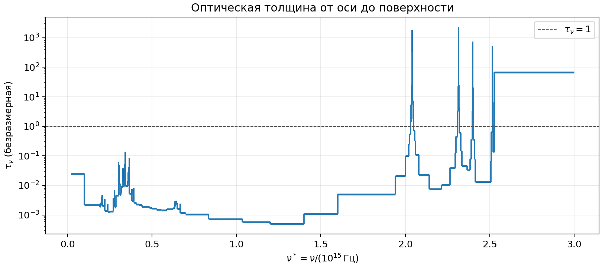
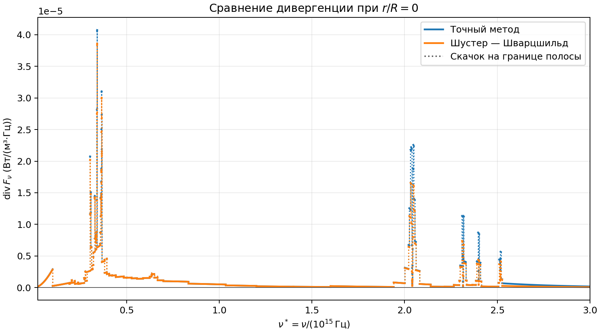
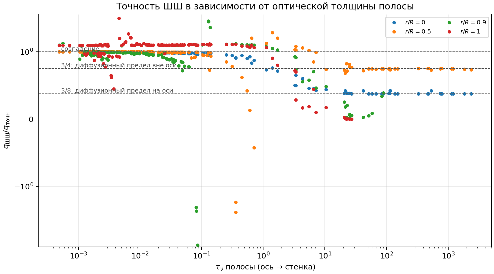
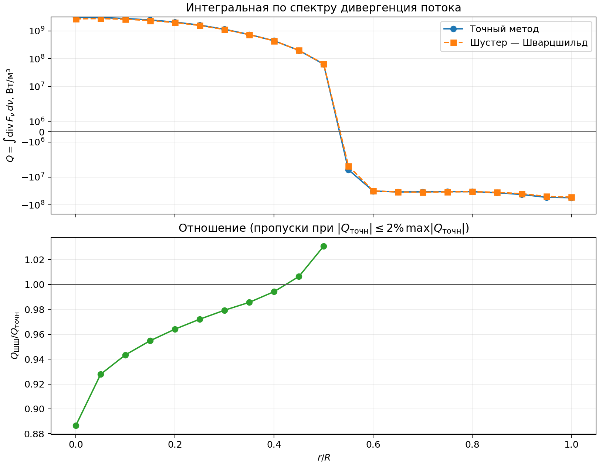

# Точность приближения Шустера — Шварцшильда при расчёте переноса излучения в цилиндрическом столбе ксеноновой плазмы с сильно неоднородным по спектру поглощением

**ЧЕРНОВИК (текстовая версия; оформленная статья — `ARTICLE.docx`).** Все числа получены при T₀ = 11 000 К, T_w = 1800 К, R = 1 см, n = 2 и в предположении, что коэффициенты поглощения заданы в м⁻¹. Единицы и параметры варианта не подтверждены. После подтверждения расчёт нужно повторить и обновить числа. Места, требующие уточнения, помечены **[уточнить]**.

**Авторы:** [уточнить]

**Организация:** МГТУ им. Н. Э. Баумана [уточнить кафедру]

## Аннотация

Исследована точность двухпоточного приближения Шустера — Шварцшильда при расчёте спектральной дивергенции лучистого потока в бесконечном цилиндре с заданным профилем температуры. Среда — ксенон при давлении 1,5 МПа. Коэффициент поглощения задан на 193 спектральных полосах, радиальная оптическая толщина которых меняется от 5·10⁻⁴ до 2,4·10³. Эталоном служит прямое интегрирование уравнения переноса вдоль лучей. Показано, что погрешность приближения определяется оптической толщиной полосы. В прозрачных полосах (τ < 0,1) отличие от точного решения не превышает нескольких процентов. В оптически толстых полосах отношение приближённой дивергенции к точной стремится к 3/4 вне оси и к 3/8 на оси; оба предела получены аналитически и подтверждены расчётом. Для интегральной по спектру дивергенции погрешность составила 11% на оси и 2–6% в остальном объёме, для потока с поверхности — 3,3%.

**Ключевые слова:** перенос излучения, приближение Шустера — Шварцшильда, двухпоточное приближение, дивергенция лучистого потока, оптическая толщина, диффузионный предел, ксеноновая плазма.

## 1. Введение

При моделировании сильноточных разрядов в инертных газах уравнение энергии содержит дивергенцию лучистого потока. Она определяет радиационные потери горячего ядра разряда и нагрев периферийных слоёв собственным излучением плазмы. Точное вычисление этой величины требует интегрирования уравнения переноса по направлениям и по спектру в каждой точке, что дорого в итерационных расчётах. Поэтому на практике применяют приближённые модели: диффузионную и двухпоточные [1–4].

Приближение Шустера — Шварцшильда [5, 6] заменяет угловое распределение интенсивности двумя полусферическими потоками. Его погрешность зависит от оптической толщины среды. В плазме с линейчатым спектром оптическая толщина на разных частотах различается на много порядков, поэтому одна и та же модель одновременно работает в прозрачном, промежуточном и диффузионном режимах. Для цилиндрической геометрии количественные данные о точности приближения в таких условиях ограничены.

Цель работы — оценить погрешность приближения Шустера — Шварцшильда для цилиндра с заданным полем температур и реальным спектром поглощения ксенона, сравнив его с прямым решением уравнения переноса.

## 2. Постановка задачи

Рассматривается бесконечный осесимметричный цилиндр радиуса R. Температура задана:

T(r) = T₀ + (T_w − T₀)(r/R)ⁿ.

Среда излучает и поглощает, рассеяние не учитывается, показатель преломления равен единице. Принято локальное термодинамическое равновесие: коэффициент излучения j_ν = k_ν B_ν(T), где B_ν — функция Планка. Внешнее излучение на границе отсутствует.

Коэффициент поглощения ксенона k_ν(T) при p = 1,5 МПа задан таблицей: 193 полосы в диапазоне ν = (0,02–3,0)·10¹⁵ Гц и 12 температур от 2000 до 13 000 К. Внутри полосы k_ν не зависит от частоты. По температуре использована линейная интерполяция; ниже 2000 К принято k_ν(T) = k_ν(2000 К) **[уточнить]**.

Искомая величина — спектральная дивергенция лучистого потока q_ν(r) = div F_ν и её интеграл по спектру Q(r) = ∫q_ν dν. Положительные значения соответствуют потерям энергии веществом.

Характеристикой полосы служит радиальная оптическая толщина

τ_ν = ∫₀ᴿ k_ν(T(r)) dr.

## 3. Методы расчёта

### 3.1. Прямое интегрирование уравнения переноса

Интенсивность в точке r в направлении Ω находится из формального решения уравнения переноса вдоль луча от поверхности до точки наблюдения:

dI_ν/ds = k_ν (B_ν − I_ν),  I_ν = 0 на входе.

Луч разбивается на отрезки, сгущающиеся к точке наблюдения. На каждом отрезке k_ν и B_ν постоянны, и уравнение интегрируется аналитически. Полупотоки и дивергенция получаются интегрированием по телесному углу:

F_ν⁺ − F_ν⁻ = ∫ I_ν (Ω·e_r) dΩ,  q_ν = k_ν ∫ (B_ν − I_ν) dΩ.

Интегралы по углам вычисляются квадратурой Гаусса — Лежандра: 20 узлов по косинусу полярного угла и 2×24 узла по азимуту, с учётом симметрии — 960 лучей на точку. Чтобы избежать потери точности в оптически толстых полосах, вдоль луча переносится непосредственно разность B_ν(T(r)) − I_ν.

### 3.2. Приближение Шустера — Шварцшильда

В приближении принимается, что интенсивность изотропна в пределах каждой из двух полусфер. Тогда полупотоки удовлетворяют уравнениям

(1/r) d(rF_ν⁺)/dr = 2k_ν(πB_ν − F_ν⁺) + f_ν,
(1/r) d(rF_ν⁻)/dr = 2k_ν(F_ν⁻ − πB_ν) + f_ν,

с условиями F_ν⁻(R) = 0 и F_ν⁺(0) = F_ν⁻(0). Член f_ν описывает переход излучения из внутренней полусферы в наружную при прохождении луча мимо оси. В работе использовано замыкание f_ν = F_ν⁻/r **[уточнить: согласовать с формулами (8)–(9) пособия]**. Тогда

dF_ν⁻/dr = 2k_ν(F_ν⁻ − πB_ν),
d(rF_ν⁺)/dr = 2k_ν r(πB_ν − F_ν⁺) + F_ν⁻.

Дивергенция потока:

q_ν = 4πk_ν B_ν − 2k_ν(F_ν⁺ + F_ν⁻).

Уравнения интегрируются на радиальной сетке с аналитическим решением в пределах ячейки. В оптически толстых полосах F_ν^± ≈ πB_ν, и прямое вычисление q_ν по последней формуле приводит к потере значащих цифр. Поэтому уравнения решаются для дефицитов D^± = πB_ν(T(r₀)) − F_ν^±, а сетка геометрически сгущается к точке наблюдения r₀.

### 3.3. Предельные случаи

**Прозрачный предел** (τ_ν → 0). Оба метода дают q_ν = 4πk_ν B_ν.

**Диффузионный предел** (τ_ν → ∞). Разложение по 1/k_ν даёт для точного решения F_ν = −(4π/3k_ν) dB_ν/dr, а для приближения F_ν = −(π/k_ν) dB_ν/dr. Следовательно, вне оси

q_ν^ШШ / q_ν^точн → 3/4.

На оси, где dB_ν/dr = 0, точное значение q_ν(0) = −(8π/3k_ν) B_ν″, а приближённое −(π/k_ν) B_ν″, откуда

q_ν^ШШ(0) / q_ν^точн(0) → 3/8.

Дополнительное занижение на оси связано с граничным условием F⁺ = F⁻ и принятым замыканием.

## 4. Проверка численной реализации

- Для однородного цилиндра приближённое решение совпадает с аналитическим с относительной погрешностью 10⁻¹⁰, в том числе при k_ν R = 100.
- В прозрачном пределе оба метода воспроизводят q_ν = 4πk_ν B_ν с погрешностью менее 0,1%.
- Интегральный баланс ∫q·2πr dr = 2πR·F(R) выполняется с погрешностью 0,5% для точного метода и 0,4% для приближённого (21 точка по радиусу).
- Диффузионные пределы 3/4 и 3/8 воспроизводятся с погрешностью менее 3%.
- Сгущение сеток вчетверо меняет результаты менее чем на 1%.

## 5. Результаты

Расчёты выполнены при T₀ = 11 000 К, T_w = 1800 К, R = 1 см, n = 2 **[уточнить]**.

### 5.1. Спектр оптической толщины

Радиальная оптическая толщина полос меняется от 4,9·10⁻⁴ до 2,4·10³, медиана равна 0,022 (рис. 1). Распределение полос: 134 с τ < 0,1; 17 с 0,1 ≤ τ < 1; 10 с 1 ≤ τ < 10; 32 с τ ≥ 10. Наиболее толстые полосы отвечают резонансным линиям ксенона в вакуумном ультрафиолете.

### 5.2. Спектральная дивергенция

На рис. 2 приведены спектры q_ν на оси. В прозрачной части спектра кривые двух методов совпадают, в области сильных линий приближение даёт заниженные значения.

Зависимость отношения q_ν^ШШ/q_ν^точн от оптической толщины полосы показана на рис. 3. На оси получено:

| τ_ν | Число полос | Медиана отношения | Диапазон |
|---|---:|---:|---|
| < 0,1 | 134 | 0,997 | 0,967–1,000 |
| 0,1–1 | 17 | 0,946 | 0,834–0,986 |
| 1–10 | 10 | 0,553 | 0,426–0,759 |
| ≥ 10 | 32 | 0,377 | 0,376–0,438 |

При τ ≥ 10 отношение на оси выходит на 3/8, при r/R = 0,5 — на 3/4 (медиана 0,746). Вблизи поверхности (r/R ≥ 0,9) в толстых полосах диффузионное приближение неприменимо, и отношение существенно отклоняется от предельных значений.

### 5.3. Интегральные характеристики

Интегральная дивергенция Q(r) показана на рис. 4. В центральной зоне Q > 0 (на оси 3,05·10⁹ Вт/м³), при r/R ≈ 0,54 знак меняется, и периферийные слои поглощают излучение ядра.

| r/R | 0 | 0,25 | 0,5 | 0,75 | 0,9 | 1,0 |
|---|---:|---:|---:|---:|---:|---:|
| Q_точн, Вт/м³ | 3,05·10⁹ | 1,61·10⁹ | 6,36·10⁷ | −3,33·10⁷ | −4,21·10⁷ | −5,49·10⁷ |
| Q_ШШ/Q_точн | 0,887 | 0,972 | 1,031 | 1,021 | 0,938 | 0,956 |

Плотность потока излучения с поверхности составляет 1,13·10⁶ Вт/м² по точному расчёту и 1,09·10⁶ Вт/м² в приближении (занижение 3,3%).

Вклад групп полос в Q на оси:

| τ_ν | Доля в Q_точн(0) | Q_ШШ/Q_точн по группе |
|---|---:|---:|
| < 0,1 | 62,5% | 0,996 |
| 0,1–1 | 17,2% | 0,928 |
| 1–10 | 13,3% | 0,585 |
| ≥ 10 | 6,9% | 0,378 |

## 6. Обсуждение

Погрешность приближения определяется оптической толщиной полосы и положением точки. Интегральная погрешность в 11% на оси складывается в основном из вклада полос с τ ≥ 1: они дают 20% радиационных потерь, и в них приближение занижает дивергенцию в 1,7–2,7 раза. Прозрачные полосы дают 62,5% потерь и рассчитываются практически точно.

Отсюда следует, что интегральная точность приближения зависит от того, какая доля энергии переносится в оптически плотной части спектра. С ростом радиуса столба или плотности газа эта доля увеличивается, и погрешность должна расти. Оценочный расчёт с коэффициентами поглощения, увеличенными в 100 раз, показал: число полос с 0,1 ≤ τ ≤ 10 возрастает с 27 до 131, а погрешность Q у поверхности достигает 11%.

В диффузионном пределе вне оси погрешность сводится к постоянному множителю 3/4. Его можно устранить перенормировкой коэффициента в двухпоточных уравнениях. В промежуточной области τ ~ 1 погрешность не сводится к множителю и зависит от радиуса.

Занижение на оси до 3/8 связано с принятым замыканием члена f_ν. Сравнение с вариантом, в котором f_ν вычисляется по касательным лучам, является предметом дальнейшей работы **[уточнить]**.

Ограничения работы: один набор параметров T₀, n, R; ступенчатая аппроксимация спектра внутри полос; заданное, а не самосогласованное поле температур.

## 7. Выводы

1. В оптически прозрачных полосах (τ < 0,1) приближение Шустера — Шварцшильда воспроизводит спектральную дивергенцию потока с погрешностью не более нескольких процентов.
2. В оптически толстых полосах отношение приближённой дивергенции к точной стремится к 3/4 вне оси и к 3/8 на оси. Пределы получены аналитически и подтверждены численно.
3. Для рассмотренного столба ксеноновой плазмы погрешность интегральной дивергенции составила 11% на оси и 2–6% в остальном объёме, погрешность потока с поверхности — 3,3%.
4. Интегральная погрешность определяется долей энергии, переносимой в полосах с τ ≥ 1, и возрастает с увеличением оптической плотности столба.

## Список литературы

Библиографические данные источников 5–8 сверены по первоисточникам (NASA ADS, EuDML, библиотека ИПМ). Для книг 1–4 число страниц не указано: его нужно взять из самих изданий.

1. Зельдович Я. Б., Райзер Ю. П. Физика ударных волн и высокотемпературных гидродинамических явлений. 2-е изд. М.: Наука, 1966.
2. Четверушкин Б. Н. Математическое моделирование задач динамики излучающего газа. М.: Наука, 1985.
3. Зигель Р., Хауэлл Дж. Теплообмен излучением / пер. с англ. под ред. Б. А. Хрусталева. М.: Мир, 1975.
4. Modest M. F. Radiative Heat Transfer. 3rd ed. Oxford: Academic Press, 2013.
5. Schuster A. Radiation through a foggy atmosphere // Astrophysical Journal. 1905. Vol. 21, no. 1. P. 1–22.
6. Schwarzschild K. Ueber das Gleichgewicht der Sonnenatmosphäre // Nachrichten von der Gesellschaft der Wissenschaften zu Göttingen. Mathematisch-Physikalische Klasse. 1906. S. 41–53.
7. Круковский А. Ю., Болдарев А. С., Ольховская О. Г. Модель Шустера — Шварцшильда для цилиндрически симметричных течений излучающего газа // Препринты ИПМ им. М. В. Келдыша. 2021. № 42. 19 с. DOI: 10.20948/prepr-2021-42.
8. Новиков А. А., Ким Д. А., Вичев И. Ю., Соломянная А. Д., Грушин А. С., Ярцев Б. Л. Численное исследование излучающей плазмы ксенона // Препринты ИПМ им. М. В. Келдыша. 2022. № 57. 15 с. DOI: 10.20948/prepr-2022-57.
